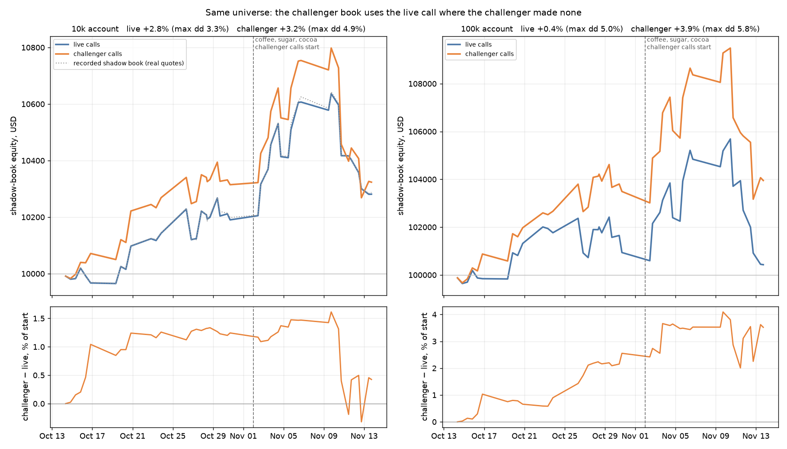
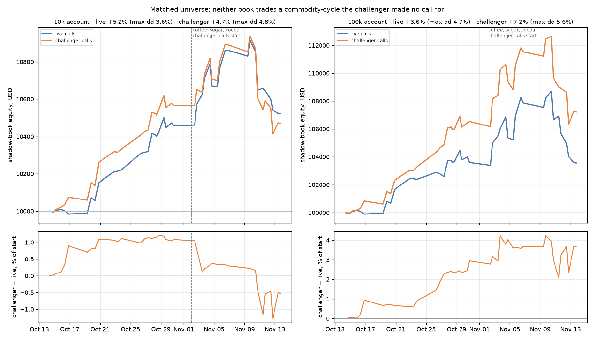

# Aligned analysts: first test against the live cycle (2026-11-14)

Written 2026-11-15. This records what was built to test ROADMAP.md Step 1 ("align the analysts"), what the
first test found, and what is still open. Design: `ROADMAP.md` § Step 1 and `ARCHITECTURE.md` § Aligned analyst
output, § Frozen inputs, § Running the challenger over past runs. Raw material (logs, per-run results, series)
is under `replays/` (gitignored); the tables below are the part worth keeping.

**Short version.** The aligned setup (every analyst hands the coordinator the same signed `bias` and `scale`, the
coordinator derives support and dissent in code) runs cleanly, costs no more than the live pipeline, and is
reproducible when rerun on frozen inputs. Its calls agree with the live ones about three times in four. On the
scorecard it is **not distinguishable from the live cycle**: every difference is inside the noise, and no analyst
shows market-neutral skill. The equity curves look better for the challenger at 100k, but that is one path
through about two to three effective weeks of one falling market. Read the per-call metrics, not the curves.

## 1. What was tested

- **Challenger:** `run_pipeline(aligned=True)`. Technical, news and weather use the aligned prompts; supply/demand
  is code. Biases are computed in code (`alignment.py`): technical from the three trend states (the model may
  move it one step with a stated reason), supply/demand from the ending-stocks revision (cocoa: grinds), news as
  a recency-weighted roll-up of headline directions, weather from the model's regional labels times the crop
  stage's weight (-1..+1). The coordinator sees the envelope and `derive_support` fixes who supports or dissents.
- **Frozen inputs** (`frozen.py`): each official run is rerun on exactly what it saw (the news articles, the
  intraday quote and the positioning from its log; everything else from the point-in-time store; no live fetch).
  Without this two runs of the same cycle disagreed, because the model picks its own news queries and Tavily
  cannot reproduce a past search.
- **Scope:** the live results are already in the official record and were not rerun. 244 official runs were rerun
  as the challenger: corn, soybeans, wheat and cotton from 2026-10-14, and coffee, sugar and cocoa from
  2026-11-02, all at the cycle times (04:00 and 16:00 ET until 2026-10-28, 06:00 and 12:30 ET since). The three
  late commodities cannot be reproduced earlier (see § 5).
- **Scored with** the Scorecard (`scoring.py`): the challenger and the official calls on the identical official
  rows (same entry price, exit close, baselines, market-neutral basket and weights), review window from
  2026-10-13.

## 2. The pilot: cost and latency

One day (2026-10-14, seven runs, one per commodity) was run first, and found two problems.

| | First pilot | After fixes | Official |
|---|---|---|---|
| Wall time, 7 runs in parallel | 390 s | **52 s** | n/a |
| Time per run | 370 to 390 s | **29 to 52 s** | n/a |
| Cost, 7 runs | $0.178 | **$0.081** | $0.086 |

- **Latency was the local price-store read, not the model.** `get_prices` listed the symbol's folder once per
  day of look-back: 26 s for one three-year read on the local mirror, and seven runs in one process queue behind
  each other. It now lists once (0.11 s, identical bars). It also cuts S3 LIST calls on the Lambda.
- **Cost was the news analyst.** A frozen search returned all 39 stored articles on every query: news prompt
  tokens 886k against 196k official. A frozen search now returns at most 10 not-yet-shown articles ranked by overlap
  with the query. News cost went from $0.132 to $0.039, equal to the official run.
- A resume guard was added (a batch records its aligned prompt hashes and a hash of the bias rules, and refuses to
  resume under others).

## 3. The batch

| | |
|---|---|
| Runs | 244 of 244, no failures |
| Wall time | 41 min (4 workers) for 224 runs, plus 12.5 min (1 worker) for the 20 cocoa reruns |
| Cost | **$3.60** against $4.26 for the same official runs (0.85x), about $0.015 a run |
| Degraded outputs | 2 news, 3 weather (none for supply/demand after the cocoa fix) |
| Technical adjusted by the model | 123 of 244 (50%) |

The first pass left all 20 cocoa supply/demand outputs degraded: the cocoa grinds are refetched on every call (like
COT), so a frozen run found nothing. An `ArchivedGrindsClient` now reads the archive and those 20 runs were rerun
(the old logs are in `aligned-v1/superseded/`).

## 4. Scorecard comparison

The challenger re-made 168 of the 252 official runs that have a 1-week exit (224 of 308 at 1 day); the missing ones
are coffee, sugar and cocoa before 2026-11-02. Both sides are scored on the same rows. Effective weeks: 2.3 at
1 week, 3.1 at 1 day.

Mean return per call (weighted; each commodity counts once per ISO week). Interval: 90%, bootstrap over
commodity-weeks.

| | Hit rate | Mean return | |
|---|---|---|---|
| **1 week, raw** | | | |
| Challenger | 71% | +1.00% | |
| Official | 71% | +0.94% | difference +0.06% (-0.64% to +0.85%) |
| Always short | 73% | +1.54% | |
| Trend rule | 47% | 0.00% | |
| **1 week, market-neutral** | | | |
| Challenger | 35% | -0.32% | |
| Official | 38% | -0.22% | difference -0.10% (-0.65% to +0.55%) |
| Always short | 40% | -0.07% | |
| Trend rule | 30% | -0.61% | |
| **1 day, market-neutral** | | | |
| Challenger | 54% | +0.01% | |
| Official | 50% | -0.03% | difference +0.04% (-0.03% to +0.10%) |
| Always short | 55% | +0.03% | |

- **Agreement with the live call:** same call 74% (1 week) and 70% (1 day); opposite direction 3%; one of the two
  neutral and the other not, 23% and 27%.
- **Pass bar:** both "not yet testable" (2.3 of 8 effective weeks; 1 of 2 required weeks in which the basket did
  not fall).
- **Per analyst, 1 week, market-neutral** (the sign of each analyst's bias as a position):

  | Analyst | Calls with a view | Hit rate | Mean return |
  |---|---|---|---|
  | Technical (final bias) | 106 | 29% | -0.48% |
  | Technical (mechanical score only) | 140 | 31% | -0.60% |
  | News | 126 | 39% | -0.10% |
  | Supply/demand | 156 | 32% | -0.64% |
  | Weather | 4 | 50% | +0.01% |

  Raw hit rates of 69% to 71% for news and supply/demand are the falling market: they were mostly bearish.
- **Technical adjustments:** the model moved the mechanical score in half the runs, mostly from a bearish score
  toward zero, with the reasoning of a downtrend stalling at a tested floor. They did not help: -0.48% against
  -0.60% for the mechanical score, hit rate 29% against 31%.
- **Weather** had a view in 4 of 168 calls: most commodities were off-season or benign, so the stage weighting
  leaves it at 0. It contributes nothing in this window.
- **Conviction (challenger, 1 week, raw):** conviction 2: 14 calls, 72% hit, +2.19%; 3: 85 calls, 73%, +1.27%;
  4: 41 calls, 67%, +0.69%. Higher conviction did worse, as with the live calls.
- **Conviction distribution (flash):** official 2/3/4 = 22/254/32 of 308; challenger 19/174/51 of 244. No 1 or 5,
  the code never had to cap one, and there are no kept rubric violations. A 5 needs all four analysts supporting
  the call, which happened in 2 of 308 official runs and 0 of 244 challenger runs (news and weather often abstain
  at 0), so the model not using a 5 is largely the inputs, not a rubric failure.

## 5. Data limits found

- **Before 2026-11-02, coffee, sugar and cocoa cannot be reproduced.** The official runs then asked about US states
  for their weather (the region-list defect in ROADMAP § 1), and the Open-Meteo forecast archive and the cocoa grind
  archive start on 2026-11-02. The current code asks the Brazilian and other regions and finds nothing.
- **A leak was closed.** Open-Meteo's forecast cannot be asked for a past date, but the code fetched today's
  forecast for any past `as_of`. A replayed `as_of` now reads only the forecast archived by that cycle.
- **The schedule moved on 2026-10-28.** News was searched in the evening and carried to 04:00, then searched at
  06:00 and carried to 12:30. A rerun does what its cycle did about the news, not what today's rule says.
- **The 12:30 runs reuse that day's carried 06:00 news output** of the same variant, so they do not retest the
  news analyst.

## 6. Equity curves (shadow book)

The shadow book (the fixed mechanical sizer behind the deterministic guardrails; no LLM) was replayed from a flat
10k and a flat 100k account on the live calls and on the challenger's, through the same M5-priced fills, over the
44 cycles since 2026-10-14 (`scripts/challenger_equity.py`). The two books differ only in their calls. The manager
stage is stubbed, so this does not show what the LLM manager would do with the challenger's calls. As a check on the
simulator, the live-calls replay ends at 10,281 against 10,287.57 for the recorded shadow book.

Where the challenger has no call, two policies are drawn: **same universe** (the challenger book uses the live
call, so both books trade all seven commodities, as the app's book does) and **matched universe** (neither book
trades a commodity-cycle the challenger made no call for, so before 2026-11-02 both trade only corn, soybeans,
wheat and cotton).

| Policy | Account | Live | Challenger | Max drawdown (live / challenger) |
|---|---|---|---|---|
| Same universe | 10k | +2.8% | +3.2% | 3.3% / 4.9% |
| Same universe | 100k | +0.4% | +3.9% | 5.0% / 5.8% |
| Matched universe | 10k | +5.2% | +4.7% | 3.6% / 4.8% |
| Matched universe | 100k | +3.6% | +7.2% | 4.7% / 5.6% |





- **The two live 10k curves differ because of sugar.** At 10k only sugar trades as a 1-lot position; coffee, cocoa
  and cotton never open one. In the same-universe book sugar lost $233 from the first cycle; the matched book
  starts sugar on 2026-11-02 and made $20 after it. That $253 swing is the gap between +2.8% and +5.2%. It cancels in
  the challenger-minus-live gap within each policy.
- **10k and 100k differ a lot from identical calls** (live +2.8% against +0.4%): integer lots and margin limits at 10k.
  The 100k curves are the better read of the calls.
- The challenger leads at 100k under both policies (+3.5 and +3.6 points) with larger drawdowns, but the sign flips at
  10k. One realization over a few effective weeks is not evidence of skill, and the per-call intervals span zero.

## 7. What can be said

The alignment works mechanically: clean envelopes, a coordinator that uses them, no more cost than live, and
reproducible reruns. In five weeks of one falling market there is **no visible gain and no visible harm**. The
sample cannot tell the two apart: 8 effective weeks, including a flat or rising stretch, are needed for the pass
bar, and the official runs used older code in the early weeks.

## 8. Open questions

- **Model for the coordinator.** The same 244 runs used 22.0M input tokens (6.4M cached) and 2.1M output tokens.
  From llmkit's table (verified 2026-10-12): DeepSeek V4 Flash $3.60 (off-peak; $7.20 at peak), V4 Pro about
  $14.50 off-peak ($29 at peak), Claude Haiku 4.5 about $27 to $32. Coordinator only (analysts reused): flash
  $1.82, V4 Pro about $7.60, Haiku about $13 to $15. DeepSeek's peak hours are 01:00 to 04:00 and 06:00 to 10:00
  UTC on weekdays; the live cycles (11:00 and 17:30 UTC) are off-peak. Haiku needs a platform change (llmkit has
  no Anthropic provider). Opinion: little expected gain on the scorecard, since the ceiling is the inputs; a
  conviction computed in code from the derived support is free and removes the rubric question, so try that first.
  A model test would also need the model recorded in the batch fingerprint.
- **Google grounding (Step 3).** The test makes it measurable (per-analyst scoring), not more likely to help.
  Freshness of news is the strongest case; weather and supply/demand are weak cases. Without a date filter it can
  only be forward-tested. Check the mechanism first: is the newest headline fresher than Tavily's?
- **BackSearch** (gr.inc, crawl-date-gated archived search; claims from its own page, untested): could give
  reproducible news searches before our logs, but its news corpus ends 2026-09-04, crawl-date gating can lag the
  live experience by days, and it does not address the model's own memory of the period. A feasibility test of about
  20 queries inside our window would settle coverage and freshness. See also
  `research/pit-news-weather-backtest-2026-11.md` for the wider survey of point-in-time sources.
- **Next:** run the challenger beside the live cycle on every new cycle (where it runs is not decided); more weeks;
  judge any change to prompts or thresholds on later weeks only, under a new batch name.

## 9. Reproducing

```
scripts/sync_local.sh logs data                # then the Dashboard's "Pull latest data" (candles)
uv run python scripts/run_challenger.py        # plan only: runs, rough cost and time
uv run python scripts/run_challenger.py --run --workers 4 --commodities corn,soybeans,wheat,cotton --since 2026-10-13
uv run python scripts/run_challenger.py --run --workers 3 --commodities coffee,sugar,cocoa --since 2026-11-02
uv run python scripts/replay_analysts.py --run-id corn_2026-11-13T11-00-00Z   # one run, live and aligned
uv run --with matplotlib python scripts/challenger_equity.py                  # the equity curves
uv run streamlit run scripts/run_chat.py       # Scorecard page: "Challenger" section
```

Batch `aligned-v1`, aligned prompts and bias rules as of this commit. A different prompt, threshold or model needs
a new `--batch` name.
